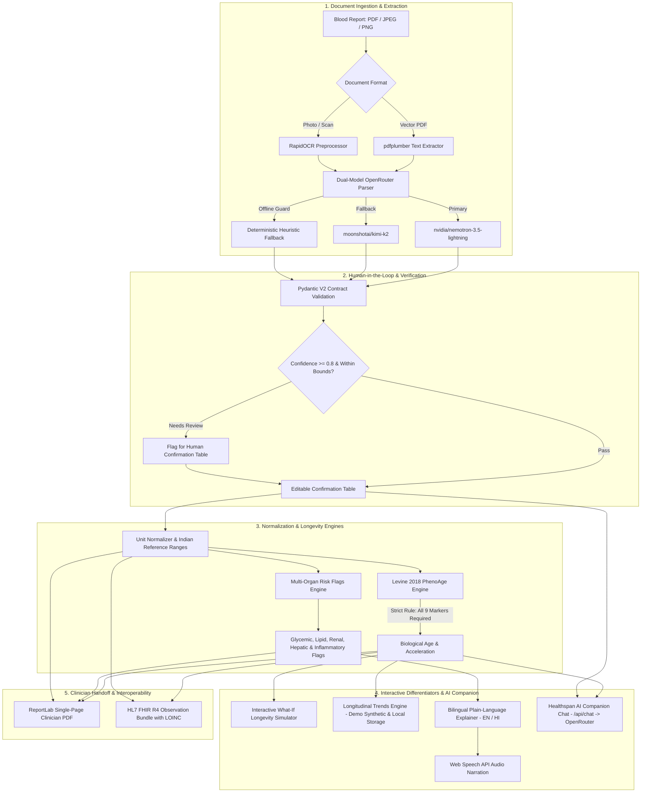

# Healthspan Passport 🩺📊
> **From blood test reports to biological age, preventive flags, and clinician handoff.**

[](https://fastapi.tiangolo.com)
[](https://nextjs.org)
[](https://hl7.org/fhir)
[](https://pytest.org)

**Healthspan Passport** ingests blood test reports (PDFs or photos), extracts and standardizes 25+ clinical biomarkers, normalizes units, computes the published **Levine et al. (2018) PhenoAge** model, flags preventive multi-organ risks, provides an interactive **AI Companion** chat (`POST /api/chat`), and exports a **one-page telemedicine doctor PDF** and an **HL7 FHIR R4 Observation Bundle**.

---

## 🏗️ System Architecture



---

## ⚡ Quickstart (Run in 3 Commands)

### 1. Install Dependencies
```bash
# Backend (Python 3.10+)
pip install -r backend/requirements.txt

# Frontend (Node 18+)
cd frontend && npm install && cd ..
```

### 2. Configure Environment (Optional)
```bash
# Optional: Set OpenRouter key for cloud LLM extraction (runs offline heuristic regex fallback if unset)
export OPENROUTER_API_KEY="your-openrouter-key"
```

### 3. Launch Development Servers
```bash
# Terminal 1: Backend API (FastAPI)
cd backend && python -m uvicorn app.main:app --host 127.0.0.1 --port 8000 --reload

# Terminal 2: Frontend (Next.js 15)
cd frontend && npm run dev
```

Visit **`http://localhost:3000`** to upload a report or test with the **15 synthetic sample reports** (`data/sample_reports/`).

---

## 📊 Validation Status

- **(a) PhenoAge Engine (Levine et al., 2018):** Implemented using the published coefficients and Gompertz parameters in [`backend/app/core/phenoage.py`](./backend/app/core/phenoage.py) and unit-tested in `pytest` (`44 passed`). [`data/synthetic_cohort_unit_test.csv`](./data/synthetic_cohort_unit_test.csv) is a **synthetic** cohort generated by [`backend/scripts/validate_nhanes.py`](./backend/scripts/validate_nhanes.py) strictly to unit-test the scoring/regression code path (not clinical validation).
- **(b) Real-NHANES Replication ([`docs/NHANES_REAL_VALIDATION.md`](./docs/NHANES_REAL_VALIDATION.md), [`data/results/nhanes_real_results.json`](./data/results/nhanes_real_results.json)):** Unweighted replication across **6 CDC NHANES cycles (1999–2010)** linked to **NCHS 2019 Public-Use Linked Mortality Files** (62,160 total $\to$ **27,256 adults** aged 20–84 excluding cycle-specific top-coded ages, mortality-eligible, complete on all 9 biomarkers; 5,212 total deaths, 3,178 within $\le 120$ months):
  - **Cox PH (adjusted for chronological age, `lifelines`):** **HR = 1.0285** per +1 year of PhenoAge acceleration (95% CI: **1.0272–1.0298**, $p < 0.0001$).
  - **Discrimination (c-index):** PhenoAge alone **0.8534** vs. chronological age alone **0.8313** (delta **+0.0222**); Pearson $r = 0.9041$.
  - **10-Year Kaplan-Meier Mortality by Acceleration Quartile:** Q1 (Lowest): 5.60% (1.00x); Q2: 6.93% (1.24x); Q3: 10.62% (1.89x); Q4 (Highest): 23.93% (4.27x).
  - **Limitations:** US population (not Indian/South Asian); unweighted NHANES sample; uses standard biochemistry-profile serum glucose (`LBXSGL`, full MEC sample, includes non-fasted); and NCHS public-use mortality files are perturbed for participant privacy so estimates may differ slightly from restricted files.
- **(c) Extraction Benchmark (`docs/VALIDATION_RESULTS.md`, `data/benchmark_metrics.json`):** Measured across **15 synthetic reports** generated by [`backend/scripts/generate_sample_reports.py`](./backend/scripts/generate_sample_reports.py) in **offline heuristic mode** (`OPENROUTER_API_KEY` unset):
  - **Overall Field-Level Accuracy:** **63.8%** (74 / 116 fields)
  - **Digital PDF Accuracy:** **88.1%** (74 / 84 fields across 8 synthetic PDFs)
  - **Phone Photo Accuracy (Offline Mode):** **0.0%** (0 / 32 fields across 7 synthetic skewed/shadowed JPGs)
  - **Unflagged Error Rate:** **1.33%** (1 / 75 extracted fields)
  - **Limitation:** Accuracy was measured on **synthetic** reports whose layouts the regex extractor was developed against, so **88.1%** likely overstates performance on real lab reports, and phone photos extract **0%** in offline mode. Live OpenRouter LLM comparison (`nvidia/nemotron-3.5-lightning` vs. `moonshotai/kimi-k2` via `backend/scripts/bakeoff.py`) has not yet been run.

---

## 🌟 Key Features

### 1. Telemedicine Clinician Handoff (`POST /api/export/pdf` & `POST /api/export/fhir`)
- **One-Page Doctor PDF:** Generates a single A4 summary for telemedicine consultations (demographics, PhenoAge box, normalized biomarkers with Indian reference ranges, active risk flags, and doctor questions).
- **HL7 FHIR R4 JSON Bundle:** Produces FHIR `Observation` resources mapped to **LOINC codes** (e.g., Fasting Glucose `1558-6`, hs-CRP `30522-7`, Albumin `1751-7`, HbA1c `4548-4`) plus a PhenoAge observation.

### 2. Interactive What-If Longevity Simulator
- Real-time client-side sliders for modifiable PhenoAge biomarkers (Fasting Glucose, hs-CRP, Albumin, Lymphocyte %, WBC, RDW) recalculating using the Levine 2018 formula.

### 3. Multi-Report Longitudinal Trends (with Synthetic Demo History)
- Recharts longitudinal charts tracking PhenoAge vs. chronological age alongside glucose, hs-CRP, and total cholesterol.
- **Demo Data (Synthetic):** Includes a 3-year **synthetic** demo trajectory (`frontend/src/data/demoTrends.ts`, 2024–2026) clearly badged in the UI, plus browser `localStorage` persistence and a clear-data button.

### 4. Plain-Language Bilingual Explainer & Voice Narration (`POST /api/explain`)
- Non-diagnostic rule-based summaries in **English** and **Hindi (हिंदी)** with Indian vegetarian nutrition guidance and Web Speech API narration (`en-IN` / `hi-IN`).

### 5. Healthspan AI Companion Chat (`POST /api/chat`)
- Report-aware floating chat widget ([`frontend/src/components/AICompanion.tsx`](./frontend/src/components/AICompanion.tsx)) backed by [`backend/app/llm/chat.py`](./backend/app/llm/chat.py) calling OpenRouter (`nvidia/nemotron-3.5-lightning`, fallback `moonshotai/kimi-k2`, configurable via `OPENROUTER_CHAT_MODEL`). Answers educational questions using confirmed biomarkers supplied from the dashboard.

---

## 🛡️ Ethics, Safety & Clinical Limitations

1. **Non-Diagnostic Educational Safeguard:**
   Healthspan Passport is an educational tool and pre-consultation summary. It does not provide medical diagnoses, treatment decisions, or prescriptions.
2. **Human-in-the-Loop Confirmation:**
   Extracted values below 80% confidence or outside physiological bounds trigger `needs_review: true` for user verification before PhenoAge is computed.
3. **Strict Missing Biomarker Rule:**
   Levine PhenoAge requires all 9 biomarkers + chronological age. If any marker (such as hs-CRP) is missing, the engine returns `phenoage: null` and lists the missing tests without imputing values.
4. **Population Transferability Notice:**
   Levine PhenoAge was trained on the US NHANES cohort. Reference ranges are adapted for Indian clinical thresholds, and biological age estimates for Indian users are informational only.

---

## 🧪 Testing & Verification

```bash
# Run full backend test suite (44 tests)
cd backend && pytest tests/

# Re-run extraction benchmark on the 15 synthetic reports (offline heuristic mode)
python backend/scripts/benchmark_extraction.py

# Run PhenoAge code-path smoke test on the synthetic unit-test cohort
python backend/scripts/validate_nhanes.py

# Run live OpenRouter LLM bake-off (requires OPENROUTER_API_KEY)
python backend/scripts/bakeoff.py

# Re-run real CDC NHANES (1999-2010) + NCHS 2019 mortality replication
python backend/scripts/nhanes_real/download.py
python backend/scripts/nhanes_real/build_cohort.py

# Production build frontend
cd frontend && npm run build
```

---

## 📄 License
MIT License.
