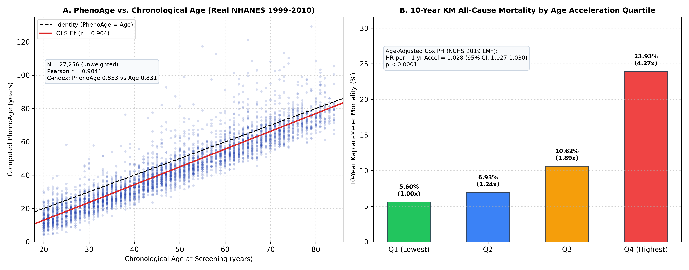

# Real CDC NHANES (1999–2010) & NCHS 2019 Linked Mortality Replication

> **Generated:** `2026-11-27T13:44:13Z`
> **Script:** [`backend/scripts/nhanes_real/build_cohort.py`](../backend/scripts/nhanes_real/build_cohort.py) (uses `calculate_phenoage` imported directly from [`backend/app/core/phenoage.py`](../backend/app/core/phenoage.py))
> **Raw Data JSON Output:** [`data/results/nhanes_real_results.json`](../data/results/nhanes_real_results.json)

---

## 1. Cohort & Participant Exclusion Flow

| Exclusion Step | Remaining $N$ | Excluded $N$ |
| :--- | ---: | ---: |
| 1. Total participants in NHANES 1999-2010 Demographics (DEMO*) | 62,160 | 0 |
| 2. Adults aged 20-84 excluding top-coded ages (>=85 in 1999-2006; >=80 in 2007-2010) | 30,798 | 31,362 |
| 3. Mortality-eligible (ELIGSTAT == 1) with non-missing MORTSTAT and PERMTH_EXM >= 0 | 29,311 | 1,487 |
| 4. Complete cases across all 9 PhenoAge biomarkers (final analytic sample) | 27,256 | 2,055 |

- **Final Analytic Cohort:** **27,256 adults** across 6 cycles (1999–2000 through 2009–2010).
- **Follow-Up (PERMTH_EXM):** Median **159.0 months** (max 249.0 months through Dec 31, 2019).
- **Mortality Events (`MORTSTAT == 1`):** **5,212** across full follow-up (**3,178** within $\le 120$ months).

---

## 2. Primary Survival & Concordance Results (Unweighted)

- **Cox Proportional Hazards (`lifelines.CoxPHFitter`, adjusted for `RIDAGEYR`):**
  - **HR per +1 year of PhenoAge Acceleration (`PhenoAge - Age`):** **1.0285** (95% CI: **1.0272–1.0298**, $p = 0.00e+00$)
  - **HR per +1 year of Chronological Age (`RIDAGEYR`):** 1.0913 (95% CI: 1.0889–1.0938)
- **Concordance Index (c-index) Comparison:**
  - **PhenoAge alone:** **0.8534**
  - **Chronological Age alone:** **0.8313**
  - **Delta (PhenoAge - Age):** **+0.0222**
- **Pearson Correlation (PhenoAge vs. Chronological Age):** **$r = 0.9041$** ($p = 0.00e+00$)

### 10-Year & Full Follow-Up Mortality by Age Acceleration Quartile

| Quartile | Accel Range (yrs) | Mean Accel | $N$ | $\le 120$m Deaths | Crude 10-Yr Mort (%) | KM 10-Yr Mort (%) | KM RR vs Q1 | Full Follow-Up Mort (%) |
| :--- | :--- | ---: | ---: | ---: | ---: | ---: | ---: | ---: |
| **Q1 (Lowest)** | -24.8 to -10.2 | -12.85 | 6,981 | 387 | 5.54% | **5.60%** | 1.00x | 11.86% |
| **Q2** | -10.1 to -6.7 | -8.41 | 6,754 | 465 | 6.88% | **6.93%** | 1.24x | 13.78% |
| **Q3** | -6.6 to -2.3 | -4.65 | 6,748 | 712 | 10.55% | **10.62%** | 1.89x | 18.08% |
| **Q4 (Highest)** | -2.2 to +171.5 | +5.53 | 6,773 | 1,614 | 23.83% | **23.93%** | 4.27x | 32.97% |

---

## 3. Variable Mapping, Unit Conversions & Glucose Choice

### Glucose Variable Rationale (`BIOPRO` `LBXSGL` vs. `GLU` Fasting)
We use **standard biochemistry profile serum glucose (`LBXSGL`)** rather than the fasting plasma glucose subsample (`GLU_*` / `LBXGLU`). In NHANES 1999–2010, fasting plasma glucose is collected only in the morning fasting subsample (~half of MEC participants), whereas `BIOPRO` (`LBXSGL`) is measured across the full examined adult cohort aged 12+ and matches the biomarker definition used in the Levine et al. (2018) NHANES IV validation cohort. Note that `LBXSGL` includes non-fasted participants.

### NHANES Variable & Unit Conversions

| NHANES Variable | PhenoAge Key | Source Unit | Target Unit (`phenoage.py`) | Conversion | Notes |
| :--- | :--- | :--- | :--- | :--- | :--- |
| `LBXSAL` | `albumin` | g/dL | g/L | `LBXSAL * 10.0` | Consistent across all 6 cycles (1999-2010) |
| `LBXSCR (1999-2000, 2003-2010) / LBDSCR (2001-2002 L40_B)` | `creatinine` | mg/dL | umol/L | `LBXSCR * 88.4` | Standard molecular-weight factor (matches backend/app/core/normalizer.py) |
| `LBXSGL` | `glucose` | mg/dL | mmol/L | `LBXSGL / 18.0182` | Biochemistry-profile serum glucose (full MEC examined sample; includes non-fasted) |
| `LBXCRP` | `crp` | mg/dL | mg/dL | `LBXCRP * 1.0` | NHANES 1999-2010 LBXCRP is already reported in mg/dL per codebooks (no /10 scaling) |
| `LBXLYPCT` | `lymphocyte_pct` | % | % | `LBXLYPCT * 1.0` | CBC automated differential |
| `LBXMCVSI` | `mcv` | fL | fL | `LBXMCVSI * 1.0` | CBC mean cell volume |
| `LBXRDW` | `rdw` | % | % | `LBXRDW * 1.0` | CBC red cell distribution width |
| `LBXSAPSI (1999-2000, 2003-2010) / LBDSAPSI (2001-2002 L40_B)` | `alp` | U/L | U/L | `LBXSAPSI * 1.0` | Biochemistry-profile alkaline phosphatase |
| `LBXWBCSI` | `wbc` | 1000 cells/uL | 10^9/L | `LBXWBCSI * 1.0` | 1000 cells/uL is numerically 1:1 equivalent to 10^9/L |

### Cycle-Specific Breakdown & Age Top-Coding
Per official CDC `DEMO*.htm` codebooks, `RIDAGEYR` is top-coded at **85** in 1999–2006 (`>=85` collapsed to 85; `20–84` un-topcoded) and at **80** in 2007–2010 (`>=80` collapsed to 80; `20–79` un-topcoded). Top-coded ages are excluded.

| Cycle | Analytic $N$ | Mean Age | Mean PhenoAge | Median Follow-Up (mo) | $\le 120$m Deaths | Full Follow-Up Deaths |
| :--- | ---: | ---: | ---: | ---: | ---: | ---: |
| `1999_2000` | 3,982 | 48.9 | 41.9 | 234.0 | 536 | 1,195 |
| `2001_2002` | 4,523 | 47.9 | 42.5 | 212.0 | 572 | 1,118 |
| `2003_2004` | 4,246 | 49.1 | 44.3 | 189.0 | 581 | 1,009 |
| `2005_2006` | 4,294 | 47.3 | 43.6 | 166.0 | 494 | 746 |
| `2007_2008` | 4,934 | 48.5 | 43.2 | 141.0 | 527 | 665 |
| `2009_2010` | 5,277 | 47.3 | 42.4 | 119.0 | 468 | 479 |

---

## 4. Limitations

1. **US Population:** NHANES is a US civilian non-institutionalized population survey. Biomarker distributions, baseline mortality rates, and cardiometabolic risk relationships differ in Indian / South Asian populations.
2. **Unweighted Analysis:** Results above are unweighted NHANES sample estimates (survey weights, strata, and PSUs were not applied), so hazard ratios and percentages reflect the analytic sample rather than weighted US national population rates.
3. **Non-Fasting Biochemistry-Profile Glucose (`LBXSGL`):** Using standard biochemistry-profile serum glucose instead of fasting plasma glucose maximizes sample size across all MEC adults but includes participants who were not fasting at blood draw.
4. **Public-Use Linked Mortality Perturbation:** Per NCHS disclosure-avoidance rules, the public-use 2019 Linked Mortality Files apply perturbation to follow-up times and/or vital status for a small subset of records to protect participant privacy; therefore, estimates may differ slightly from NCHS restricted-use linked mortality files.

---

## 5. Official Data Sources Downloaded (`data/nhanes_raw/download_manifest.json`)

- `https://ftp.cdc.gov/pub/Health_statistics/NCHS/datalinkage/linked_mortality/R_ReadInProgramAllSurveys.R`
- `https://wwwn.cdc.gov/Nchs/Data/Nhanes/Public/1999/DataFiles/DEMO.xpt`
- `https://wwwn.cdc.gov/Nchs/Data/Nhanes/Public/1999/DataFiles/LAB25.xpt`
- `https://wwwn.cdc.gov/Nchs/Data/Nhanes/Public/1999/DataFiles/LAB18.xpt`
- `https://wwwn.cdc.gov/Nchs/Data/Nhanes/Public/1999/DataFiles/LAB11.xpt`
- `https://ftp.cdc.gov/pub/Health_Statistics/NCHS/datalinkage/linked_mortality/NHANES_1999_2000_MORT_2019_PUBLIC.dat`
- `https://wwwn.cdc.gov/Nchs/Data/Nhanes/Public/2001/DataFiles/DEMO_B.xpt`
- `https://wwwn.cdc.gov/Nchs/Data/Nhanes/Public/2001/DataFiles/L25_B.xpt`
- `https://wwwn.cdc.gov/Nchs/Data/Nhanes/Public/2001/DataFiles/L40_B.xpt`
- `https://wwwn.cdc.gov/Nchs/Data/Nhanes/Public/2001/DataFiles/L11_B.xpt`
- `https://ftp.cdc.gov/pub/Health_Statistics/NCHS/datalinkage/linked_mortality/NHANES_2001_2002_MORT_2019_PUBLIC.dat`
- `https://wwwn.cdc.gov/Nchs/Data/Nhanes/Public/2003/DataFiles/DEMO_C.xpt`
- `https://wwwn.cdc.gov/Nchs/Data/Nhanes/Public/2003/DataFiles/L25_C.xpt`
- `https://wwwn.cdc.gov/Nchs/Data/Nhanes/Public/2003/DataFiles/L40_C.xpt`
- `https://wwwn.cdc.gov/Nchs/Data/Nhanes/Public/2003/DataFiles/L11_C.xpt`
- `https://ftp.cdc.gov/pub/Health_Statistics/NCHS/datalinkage/linked_mortality/NHANES_2003_2004_MORT_2019_PUBLIC.dat`
- `https://wwwn.cdc.gov/Nchs/Data/Nhanes/Public/2005/DataFiles/DEMO_D.xpt`
- `https://wwwn.cdc.gov/Nchs/Data/Nhanes/Public/2005/DataFiles/CBC_D.xpt`
- `https://wwwn.cdc.gov/Nchs/Data/Nhanes/Public/2005/DataFiles/BIOPRO_D.xpt`
- `https://wwwn.cdc.gov/Nchs/Data/Nhanes/Public/2005/DataFiles/CRP_D.xpt`
- `https://ftp.cdc.gov/pub/Health_Statistics/NCHS/datalinkage/linked_mortality/NHANES_2005_2006_MORT_2019_PUBLIC.dat`
- `https://wwwn.cdc.gov/Nchs/Data/Nhanes/Public/2007/DataFiles/DEMO_E.xpt`
- `https://wwwn.cdc.gov/Nchs/Data/Nhanes/Public/2007/DataFiles/CBC_E.xpt`
- `https://wwwn.cdc.gov/Nchs/Data/Nhanes/Public/2007/DataFiles/BIOPRO_E.xpt`
- `https://wwwn.cdc.gov/Nchs/Data/Nhanes/Public/2007/DataFiles/CRP_E.xpt`
- `https://ftp.cdc.gov/pub/Health_Statistics/NCHS/datalinkage/linked_mortality/NHANES_2007_2008_MORT_2019_PUBLIC.dat`
- `https://wwwn.cdc.gov/Nchs/Data/Nhanes/Public/2009/DataFiles/DEMO_F.xpt`
- `https://wwwn.cdc.gov/Nchs/Data/Nhanes/Public/2009/DataFiles/CBC_F.xpt`
- `https://wwwn.cdc.gov/Nchs/Data/Nhanes/Public/2009/DataFiles/BIOPRO_F.xpt`
- `https://wwwn.cdc.gov/Nchs/Data/Nhanes/Public/2009/DataFiles/CRP_F.xpt`
- `https://ftp.cdc.gov/pub/Health_Statistics/NCHS/datalinkage/linked_mortality/NHANES_2009_2010_MORT_2019_PUBLIC.dat`
